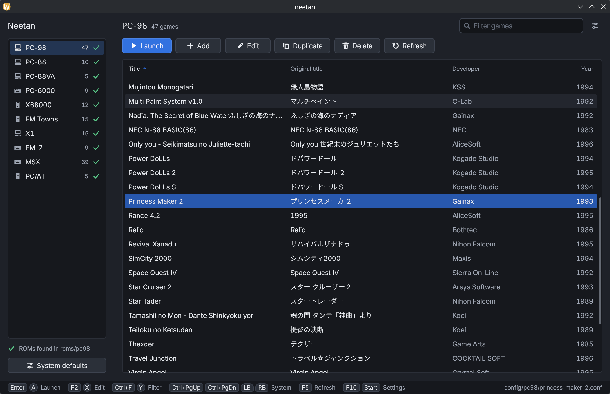
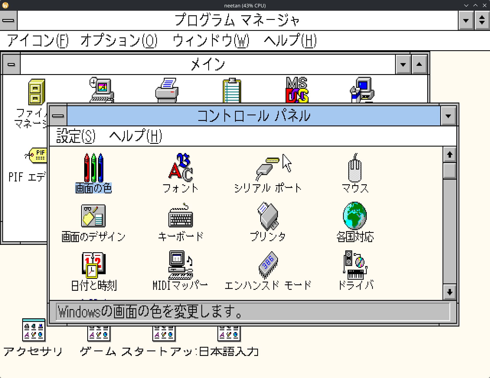

# Neetan (ねーたん)

Neetan is an emulator of Japanese personal computers of the 1980s and 1990s written
in Rust. A game manager keeps one library of games for each system and starts them
with their own configuration.

[Download](https://github.com/neetandev/neetan/releases) |
[Documentation](#documentation) |
[Building](#building) |
[License](#license)

<p align="center">
  
  
</p>

## Supported systems

| Family                                         | Compatibility              |
|------------------------------------------------|----------------------------|
| [NEC PC-9801 / PC-9821](doc/machine-pc98.md)   | [List](doc/games-pc98.md)  |
| [NEC PC-88VA2](doc/machine-pc88va.md)          | [List](doc/games-88va.md)  |
| [NEC PC-8001 / PC-8801](doc/machine-pc88.md)   | -                          |
| [NEC PC-6001 / PC-6601](doc/machine-pc6000.md) | -                          |
| [MSX / MSX2 / MSX2+](doc/machine-msx.md)       | [List](doc/games-msx.md)   |
| [Fujitsu FM Towns](doc/machine-towns.md)       | [List](doc/games-towns.md) |
| [Fujitsu FM-7 / FM-77AV](doc/machine-fm7.md)   | [List](doc/games-fm7.md)   |
| [Sharp X68000](doc/machine-x68k.md)            | [List](doc/games-x68k.md)  |
| [Sharp X1](doc/machine-x1.md)                  | -                          |
| [IBM PC/AT (DOS/V)](doc/machine-at.md)         | [List](doc/games-at.md)    |

Neetan contains no ROM files. The PC-98 and the PC/AT run without ROM files on a
built-in HLE BIOS. All other families need a ROM set dumped from the real machine.
[ROMs](doc/roms.md) lists the files of each set. The PC-98 even does not need an
operating system, since it ships with an MS-DOS 6.2 compatible DOS.

## Features

* Game manager with one library for each system.
* Yamaha FM synthesis through a Rust port of ymfm. Roland MT-32 and SC-55 emulation
  through Rust ports of munt and Nuked-SC55.
* CRT effect, pixel-art scaling and a choice of 4:3 or square pixel aspect.
* Quick save and restore of the full machine state in memory.
* Copy of on-screen Japanese text to the clipboard on the PC-98, for use with
  translation tools.
* Built-in MS-DOS 6.20 compatible DOS with EMS, XMS and MSCDEX drivers for the PC-98.
* User interface in English, Japanese, German, French, Spanish, Simplified Chinese
  and Traditional Chinese.
* Commands to create disk images, convert hard disk images and copy files into
  FAT-formatted images.
* A headless frontend, `neetan-auto`, that runs R7RS Scheme scripts against a machine
  at exact frame boundaries.

## CPU cores

We try to provide the best possible accuracy for CPUs where game software actually depended on exact timing behaviour.
The older the CPUs are, the more important cycle exact timings become.

| CPU     | Systems                        | Timing                                                                         |
|---------|--------------------------------|--------------------------------------------------------------------------------|
| Z80     | PC-88, PC-6000, MSX, X1        | Cycle-count accurate                                                           |
| MC6809  | FM-7                           | Cycle-count accurate against test data of the MAME core                        |
| MC68000 | X68000                         | Cycle-exact, microcoded. Port the MAME core                                    |
| 8086    | PC-9801F                       | Cycle-count accurate                                                           |
| V30     | PC-9801VM, PC-88VA             | Cycle-count accurate                                                           |
| 80286   | PC-9801VX                      | Calibrated against real 80286 traces, within 1% of the real cycle count        |
| 80386SX | PC-9801RS, FM Towns            | Calibrated against real 386EX traces, within 1% of the real cycle count        |
| 80386DX | PC-9801RA, FM Towns II CX      | Datasheet timings                                                              |
| 80486   | PC-9821, FM Towns II MX, PC/AT | Datasheet timings                                                              |

The tests are the [SingleStepTests](https://github.com/SingleStepTests) per-instruction
suites and [test386.asm](https://github.com/barotto/test386.asm). The 80386 and 80486
cores include an x87 FPU with 80-bit floating point.

## Getting started

Release archives for Windows (x86-64) and Linux (x86-64 AppImage) are available on the
[releases page](https://github.com/neetandev/neetan/releases). An archive holds a
portable installation:

```
neetan.conf      settings file
config/<system>/ game files of each system
roms/<system>/   ROM set of each system
```

1. Unpack the archive.
2. Copy the ROM sets into the folders below `roms/`. See [ROMs](doc/roms.md).
3. Start `neetan`. The game manager opens. Add games to the library of a system and
   launch them.

Right Ctrl is the shortcut key of the emulator. `Right Ctrl + Esc` returns to the
manager and `Right Ctrl + M` captured the mouse when inside a game.
See [Controls](doc/controls.md) lists all shortcuts.

Neetan can also start a machine and game directly from the command line:

```bash
neetan --machine PC9801RA --fdd1 disk.d88
neetan --config config/pc98/albatross.conf
```

We suggest that you store game files under `games/`. Its organisation is not enforced
by the emulator.

## Documentation

* Systems: [PC-9801 / PC-9821](doc/machine-pc98.md),
  [PC-88VA2](doc/machine-pc88va.md),
  [PC-8001 / PC-8801](doc/machine-pc88.md),
  [PC-6001 / PC-6601](doc/machine-pc6000.md),
  [MSX](doc/machine-msx.md),
  [FM Towns](doc/machine-towns.md),
  [FM-7 / FM-77AV](doc/machine-fm7.md),
  [X68000](doc/machine-x68k.md),
  [X1](doc/machine-x1.md),
  [PC/AT (DOS/V)](doc/machine-at.md)
* [ROMs](doc/roms.md): the ROM files of every system
* [Controls](doc/controls.md): shortcuts, mouse capture and quick save
* [Command line](doc/command-line.md): options, machine types and commands
* [Configuration](doc/configuration.md): settings file, folder layout, game files and
  key bindings
* [Disk images](doc/disk-images.md): image formats and disk image tools
* [Automation](doc/api.md): `neetan-auto` and its Scheme API
* [Building](doc/building.md): requirements, build features and binary license

## Building

Neetan needs [Rust 1.97](https://rustup.rs/), [SDL3](https://github.com/libsdl-org/SDL)
and on Linux the [mold linker](https://github.com/rui314/mold).

```bash
cargo build --release
```

[Building](doc/building.md) describes the SDL3 options and the build features that
select machine families and frontends.

## Contributing

Compatibility reports, bug reports and pull requests are welcome. Issues and pull
requests can be written in English or Japanese. See [CONTRIBUTING.md](CONTRIBUTING.md).

IssueとPull Requestは日本語でも英語でも受け付けています。

## Acknowledgements

These projects provided references and test vectors for the implementation:

* [Common Source Code Project](https://takeda-toshiya.my.coocan.jp/common/index.html)
* [MAME](https://www.mamedev.org/)
* [MartyPC](https://github.com/dbalsom/martypc)
* [NP21W](https://simk98.github.io/np21w/)
* [openMSX](https://openmsx.org/)
* [Tsugaru](https://github.com/captainys/TOWNSEMU)
* [XEiJ](https://stdkmd.net/xeij/)
* [SingleStepTests](https://github.com/SingleStepTests)
* [undoc98](https://www.webtech.co.jp/company/doc/undocumented_mem/index.html)

Neetan contains Rust ports of these projects:

* [ymfm](https://github.com/aaronsgiles/ymfm): Yamaha OPM, OPN and OPL emulation
* [Nuked-SC55](https://github.com/nukeykt/Nuked-SC55): Roland SC-55 emulation
* [munt](https://github.com/munt/munt): Roland MT-32 emulation

## License

The source code of Neetan is licensed under the
[3-clause BSD](https://opensource.org/license/bsd-3-clause) license.

The optional SC-55 and MT-32 emulations are licensed under the
[GPL 2.0 or later](https://www.gnu.org/licenses/old-licenses/gpl-2.0.html) and the
[LGPL 2.1](https://www.gnu.org/licenses/old-licenses/lgpl-2.1.html). Both are part of
the default build and of the release binaries. These binaries are licensed under the
GPL 2.0 or later. [Building](doc/building.md#midi-features-and-binary-license) shows
the license of each build configuration. The source code of the BSD 3-Clause licensed
components remains available under BSD 3-Clause in every build configuration.

The license notices of the embedded third-party components are collected in the
[`licenses/`](licenses/) folder, which is included in every release.
